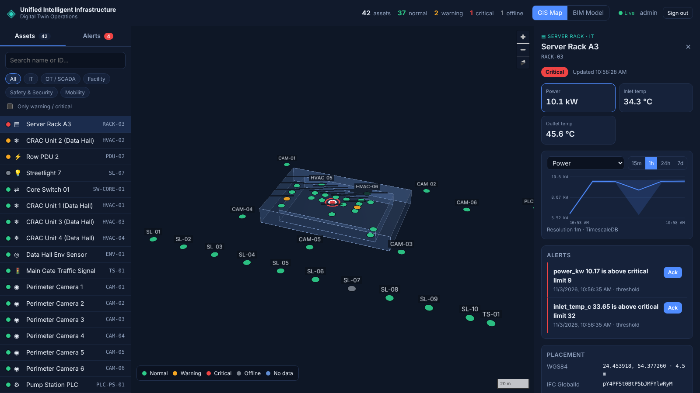
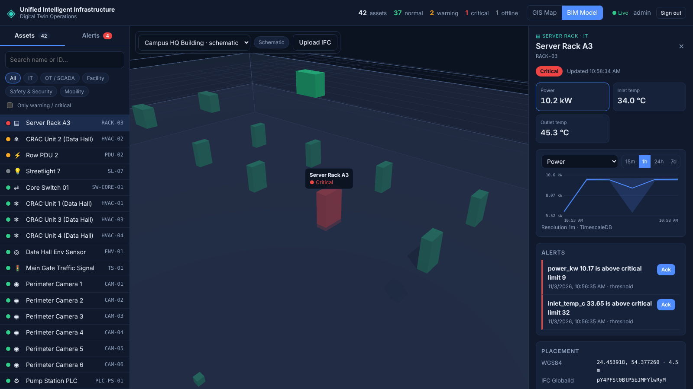

# Unified Intelligent Infrastructure — Digital Twin Platform

**Connect Everything. Understand Anything. Automate Intelligence.**

A decoupled, event-driven platform that unifies IT/OT infrastructure, GIS and BIM in one spatial console. Live telemetry from field devices (MQTT, HTTP, BACnet/Modbus via dynamic schema mapping) flows through Kafka, is checked for anomalies, stored in TimescaleDB and pushed in real time onto map markers and BIM objects.

- **Smart Cities / Government** — sovereign AI and unified operations for critical public infrastructure. Every component is self-hosted; the default basemap needs no external token and an offline style ships in the box.
- **Manufacturing / Utilities** — bridging the IT/OT gap to turn reactive maintenance into predictive operational intelligence.





## Architecture

```
 Field / OT                    Streaming                         Processing                       Persistence
 PLC · RTU · BACnet ──MQTT──►  Mosquitto ──► ingest-bridge ──►  Kafka dt.telemetry.raw ──► worker ×N ──► TimescaleDB
 HVAC · PDU · sensors          (auth, ACL)   normalise +         (12 partitions,            validate      hypertables, compression,
 HTTP devices ──────────────────────────────► schema mapping     keyed by deviceId)         detect        retention, 1m/1h CAGGs
                                              │                                              │  │
                                              └─► dt.telemetry.dlq (unparseable)            │  ├─► dt.telemetry.anomalies
                                                                                            │  ├─► dt.device.state (compacted)
                                                                                            │  └─► Redis HSET + PUBLISH dt:state:*
 Browser                       Gateway                         API                            │
 Next.js console ─REST/WS─►   Gravitee APIM ─────────────►   NestJS (stateless) ◄───────────┘ socket.io fan-out (≤10 Hz)
 MapLibre + deck.gl (GIS)      plans · rate limit ·           ├─► PostGIS   assets · GeoJSON · IFC GUIDs · rules
 Three.js + web-ifc (BIM)      analytics · dev portal         ├─► TimescaleDB history · anomalies
                                                              └─► Kafka     dt.asset.events · dt.ifc.jobs ──► worker IFC parser
```

| Layer | Component | Responsibility |
|---|---|---|
| Spatial UI | `apps/web` — Next.js 15, MapLibre GL + deck.gl, Three.js + web-ifc | GIS map with extruded BIM envelopes, BIM viewport (schematic or full IFC), live status, history charts, alert triage |
| Gateway | Gravitee APIM 4.x (OSS) + `apps/gateway-provisioner` | Single entrypoint for REST and WebSocket, rate limiting, analytics, developer portal; APIs imported and deployed automatically |
| API | `apps/api` — NestJS | Asset CRUD as GeoJSON, bbox / radius / text search, bulk GeoJSON import, devices, dynamic schema mappings, alert rules, telemetry history, anomalies, IFC upload, socket.io gateway, JWT + RBAC |
| Ingest | `apps/ingest-bridge` | MQTT → Kafka; canonical payloads or vendor payloads mapped at runtime; PUBACK withheld until Kafka write (at-least-once) |
| Worker | `apps/worker` | Schema validation, threshold + rolling z-score detection with hysteresis, idempotent batch writes, live-state fan-out, offline detection, IFC parsing |
| Migrations | `apps/migrator` | Versioned, checksummed SQL for both stores; demo seed |
| Simulator | `apps/simulator` | 41 devices across HVAC, racks, PDUs, UPS, CCTV, streetlights, BACnet AHUs and a Modbus pump PLC, with injected fault episodes |
| Contracts | `packages/contracts` | Zod schemas, Kafka/MQTT topic contract, socket.io event types — shared by every service and the browser |

### Design decisions

- **Kafka in KRaft mode** — ZooKeeper is removed in Kafka 4.x.
- **MQTT at the edge, Kafka as the backbone** — MQTT is what OT gateways speak; Kafka gives durable, replayable, partitioned streams. Redis is used only for sub-second fan-out to WebSocket clients.
- **Two Postgres engines** — PostGIS (spatial OLTP) and TimescaleDB (write-heavy telemetry) scale and tune independently.
- **Narrow telemetry table** — one row per reading, so a new device class or metric needs no schema change.
- **Dynamic schema mapping** — vendor payloads (BACnet object dumps, Modbus registers, proprietary JSON) are mapped by rules stored in PostGIS and editable through the API (`PUT /schema-mappings`, dry-run with `POST /schema-mappings/test`).
- **At-least-once, idempotent** — offsets commit only after the Timescale write; a unique index on `(message_id, metric, time)` absorbs redelivery; only strictly newer readings drive anomaly detection.
- **Gateway as policy point** — the browser never talks to the API directly. Identity is the platform JWT (validated by the API); the gateway applies throttling and analytics.

## Quick start

Requirements: Docker 24+ with Compose v2, ~10 GB RAM for the full stack.

```bash
cp .env.example .env            # replace every CHANGE_ME value
docker compose --profile sim up -d --build
```

Open **http://localhost:3000** and sign in with `AUTH_ADMIN_USERNAME` / `AUTH_ADMIN_PASSWORD`. The simulator starts streaming within a minute and fault episodes begin turning assets amber and red.

| Service | URL (127.0.0.1) | Notes |
|---|---|---|
| Console | http://localhost:3000 | Next.js |
| Gateway (REST + WS) | http://localhost:8082/dt/v1 · /dt/realtime | Gravitee |
| Gravitee Console / Portal | http://localhost:8084 · :8085 | `admin` / `admin` — **change on first login** |
| API direct (debug) | http://localhost:4000/api/v1 | |
| Kafka UI | http://localhost:8080 | `--profile tools` |
| PostGIS / TimescaleDB | 5432 / 5433 | |
| MQTT / MQTT-WS | 1883 / 9001 | |

To run without the gateway (smaller hosts), point the browser straight at the API: set `NEXT_PUBLIC_API_URL=http://localhost:4000/api/v1`, `NEXT_PUBLIC_WS_URL=http://localhost:4000/realtime`, and start only the services you need.

### Local development

```bash
pnpm install
pnpm dev:infra                       # postgis, timescaledb, kafka, mosquitto, redis
pnpm build && pnpm migrate           # schema + demo seed
node apps/api/dist/main.js           # each service reads .env-style variables
pnpm --filter @dt/web dev
pnpm test                            # unit tests: contracts, detector, ingest normaliser
```

## Connecting devices

**MQTT** — `dt/v1/{tenantId}/{deviceId}/telemetry` (QoS 1), credentials `MQTT_DEVICE_USERNAME` / `MQTT_DEVICE_PASSWORD`:

```json
{ "ts": 1762156800000, "readings": [ { "metric": "temperature_c", "value": 23.4, "unit": "C" } ] }
```

Status: `dt/v1/{tenantId}/{deviceId}/status` with `{"online": true}` or the bare string `offline`.

**Vendor payloads** — bind the device to a schema mapping and publish native JSON:

```json
{ "timestampPath": "timestamp", "timestampUnit": "s",
  "fields": [ { "path": "objects.ZN-T.presentValue", "metric": "temperature_c", "unit": "C", "scale": 0.1 } ] }
```

**HTTP** — `POST /dt/v1/telemetry/ingest` with a bearer token: `{ "deviceId": "rack-01", "readings": [...] }`.

## API reference (via gateway `/dt/v1`)

| Method & path | Purpose |
|---|---|
| `POST /auth/token` | Exchange credentials for a JWT |
| `GET /assets?bbox=&type=&domain=&q=&modelId=&tag=&limit=&cursor=` | GeoJSON FeatureCollection, keyset-paginated |
| `GET /assets/nearby?lon=&lat=&radius=` | Geography radius search, nearest first |
| `GET /assets/summary` | Counts by type/domain and spatial extent |
| `GET /assets/:id` · `POST /assets` · `PATCH /assets/:id` · `DELETE /assets/:id` | CRUD (accepts a GeoJSON Feature or plain object) |
| `POST /assets/import` | Bulk upsert from a FeatureCollection (matched on `externalId`) |
| `GET /devices` · `PUT /devices` · `DELETE /devices/:id` | Device registry and asset binding |
| `GET /schema-mappings` · `PUT /schema-mappings` · `POST /schema-mappings/test` | Dynamic schema mapping |
| `GET /alert-rules` · `POST /alert-rules` · `DELETE /alert-rules/:id` | Thresholds per asset or asset type |
| `GET /telemetry/latest` · `GET /telemetry/series` · `GET /telemetry/metrics` · `POST /telemetry/ingest` | Live state, history (auto 10 s / 1 m / 1 h resolution), ingestion |
| `GET /anomalies` · `GET /anomalies/stats` · `POST /anomalies/:id/ack` | Alert history and acknowledgement |
| `GET /bim-models` · `POST /bim-models` (multipart IFC) · `POST /bim-models/schematic` · `GET /bim-models/:id/elements` · `GET /bim-models/:id/file` | BIM models and parsed IFC elements |
| `GET /health/live` · `GET /health/ready` | Probes (no prefix, no auth) |

Roles: `viewer` (read), `operator` (create/update, acknowledge), `admin` (delete), `device` (ingest only).

**Realtime** — socket.io namespace `/twin`, path `/dt/realtime/socket.io`, `auth: { token }`. Emit `subscribe` with `{ bbox?, assetIds?, minStatus? }`; receive `state:snapshot`, `state:batch` and `anomaly`.

## Repository layout

```
apps/
  api/                  NestJS REST + socket.io
  worker/               Kafka consumer, anomaly detection, IFC parser
  ingest-bridge/        MQTT → Kafka with schema mapping
  simulator/            Device fleet simulator
  migrator/             SQL migrations (sql/postgis, sql/timescale) + seed
  gateway-provisioner/  Gravitee API definitions (apis/*.json) + importer
  web/                  Next.js spatial console
packages/
  contracts/            Shared schemas, topics, realtime events
  common/               Logging, config, lifecycle, retry
  db/                   Pools and transactions for both stores
infra/                  Dockerfiles, Kafka topic bootstrap, Mosquitto config
samples/                Minimal IFC4 model for testing the upload pipeline
scripts/gen-seed.py     Regenerates the demo campus seed
```

## Production hardening

- Kafka: 3 brokers, `KAFKA_REPLICATION_FACTOR=3`, SASL_SSL listeners.
- Mosquitto: enable the TLS listener (8883) with client certificates and per-device credentials.
- Gravitee: change the admin password; switch the plan to JWT or OAuth2 against the customer IdP (Keycloak, Entra ID, UAE PASS); enable Elasticsearch security.
- API: replace local users with the customer IdP; set `AUTH_DISABLED=false` (default).
- Secrets: move `.env` values to Docker/Kubernetes secrets or Vault.
- Map: point `NEXT_PUBLIC_MAP_STYLE_URL` at a self-hosted vector-tile server, or `/styles/offline-dark.json` for air-gapped sites.
- Scale: `WORKER_REPLICAS` up to the partition count; multiple `ingest-bridge` replicas with `MQTT_SHARED_GROUP`; multiple API replicas behind the gateway (enable sticky sessions if clients fall back to long-polling).
